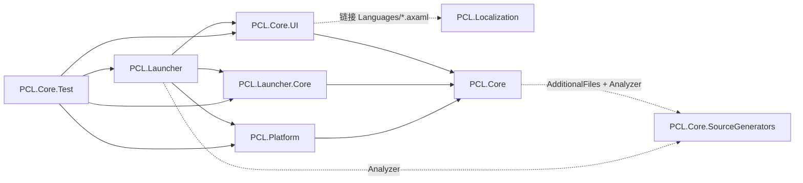
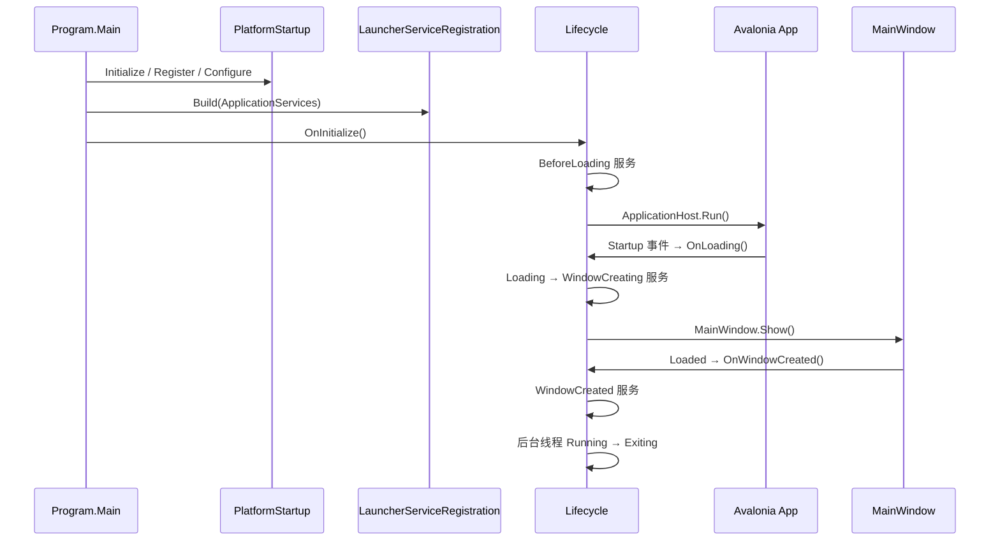

# 01 · 架构总览

## 1. 总体定位

PCL CE 是一个基于 .NET 10 与 Avalonia 的 Minecraft 启动器。代码按“**核心抽象 → 平台/UI 适配 → 业务核心 → 界面组合根**”分层，目标是让业务逻辑与具体 UI 框架、操作系统 API 解耦，从而同时支持 Windows、Linux 和 macOS。

整体由 8 个项目组成（详见 [02-解决方案与项目结构.md](02-解决方案与项目结构.md)）：

| 层 | 项目 | 角色 |
|---|---|---|
| 入口 / 表现层 | `PCL.Launcher` | Avalonia 应用、页面、ViewModel、导航、组合根 |
| UI 适配层 | `PCL.Core.UI` | 把 `PCL.Core` 的 UI 抽象实现为 Avalonia 版本 |
| 业务核心 | `PCL.Launcher.Core` | Minecraft 安装、启动、下载、整合包、社区资源、更新 |
| 平台原生层 | `PCL.Platform` | Windows / Linux / macOS / POSIX 原生能力 |
| 核心基础设施 | `PCL.Core` | 配置、生命周期、日志、事件总线、IO、网络、Minecraft 基础模型 |
| 编译期工具 | `PCL.Core.SourceGenerators` | 配置项、生命周期服务、依赖收集等增量源生成器 |
| 本地化资源 | `PCL.Localization` | 与 UI 框架无关的语言资源目录 |
| 测试 | `PCL.Core.Test` | MSTest 单元测试与架构约束测试 |

## 2. 依赖关系



依赖约束（也是架构测试关注点）：

- `PCL.Core` **不得**引用 Avalonia、`PCL.Launcher`、`PCL.Launcher.Core`。
- `PCL.Launcher.Core` **不得**引用 Avalonia 控件。
- `PCL.Core.UI` 与 `PCL.Platform` 只能依赖 `PCL.Core`。
- 只有 `PCL.Launcher` 允许同时引用所有实现项目，并负责选择具体实现。

## 3. 启动时序

### 3.1 `Program.Main`（`PCL.Launcher/Program.cs`）

```text
PlatformDetector.Detect()
  └─ PlatformStartup.Initialize(kind, args)            // 平台早期初始化
       └─ 平台实现：WindowsPlatformStartup / LinuxPlatformStartup / MacOsPlatformStartup

PlatformRegistration.Register(kind)
  ├─ PlatformModuleFactory.Create(kind)                // PlatformModule + Capabilities
  ├─ UiModuleFactory.Create(kind)                      // UiModule
  └─ ApplicationRuntime.Initialize(ApplicationServices)

LauncherServiceRegistration.Build(applicationServices) // 构建 DI 容器
  ├─ services.AddPlatformServices(kind)
  ├─ services.AddAvaloniaUi(kind)
  ├─ 注册导航、页面目录、PageHostFactory、PageViewFactory
  ├─ services.AddLauncherUi()
  ├─ UiServiceRegistration.Validate(services)
  └─ BuildServiceProvider(ValidateOnBuild = true, ValidateScopes = true)

StartupCommandHandler.TryHandle(args, serviceProvider) // CLI 命令可直接返回

PlatformStartup.Configure(kind)                        // 构造 Avalonia AppBuilder
PageRegistry.Initialize(PageHostFactory)
AnimationRegistration.Register()
ApplicationService.Loading     = () => new ApplicationHost(() => builder.StartWithClassicDesktopLifetime(args))
MainWindowService.Loading      = () => new MainWindow() + WindowContext
Lifecycle.OnInitialize()
```

### 3.2 生命周期驱动的启动

`Lifecycle.OnInitialize()` 是所有组件的总闸门：

1. 将当前线程命名为 `STA`；
2. 注册 `AppDomain.UnhandledException`、`ProcessExit`、`TaskScheduler.UnobservedTaskException`；
3. 注册系统服务；
4. 实例化所有 `LifecycleState.Manual` 服务；
5. 依次启动 `BeforeLoading` 状态的服务（`ApplicationService` 以 `int.MinValue` 优先级创建应用容器）；
6. 调用 `CurrentApplication.Run()`，进入 Avalonia 经典桌面消息循环。

Avalonia 初始化完成后：

- `App.OnFrameworkInitializationCompleted` 调用 `ApplicationHost.Attach(this)`；
- `ApplicationHost` 发布 `Startup` 事件，触发 `Lifecycle.OnLoading()`；
- 启动 `Loading` 到 `WindowCreating` 状态的服务（日志、配置、主窗体等），随后显示主窗体；
- `MainWindow.Loaded` 触发 `Lifecycle.OnWindowCreated()`，启动 `WindowCreated` 服务，并在后台线程进入 `Running` 状态。



## 4. 生命周期模型

`PCL.Core/App/IoC` 实现了一套自研的、带优先级的服务生命周期管理。

### 4.1 状态

| 状态 | 用途 | 同步服务执行线程 |
|---|---|---|
| `Manual` | 不被自动启动，只能 `Lifecycle.StartService/StopService` | 任意线程 |
| `BeforeLoading` | 预加载：单例检测、提权等 | STA |
| `Loading` | 基本组件：日志、配置、系统信息 | STA |
| `Loaded` | 非基本功能组件：RPC、Yggdrasil 服务端等 | STA（不建议同步阻塞） |
| `WindowCreating` | 主窗体内容初始化 | STA |
| `WindowCreated` | 依赖已创建窗体的事件：提示、主题刷新 | STA |
| `Running` | 正常运行后的工作：检查更新等 | 新的工作线程 |
| `Closing` | 关闭前（预留） | STA |
| `Exiting` | 退出流程 | 任意线程 |

### 4.2 服务声明

- `[LifecycleService(LifecycleState.X, Priority = n)]`：声明服务在哪个状态启动，`Priority` 越大越先启动。
- `ILifecycleService`：必须实现 `Identifier`、`Name`、`SupportAsync`、`StartAsync`、`StopAsync`。
- `[LifecycleScope("id", "名称", asyncStart)]`：源生成器据此自动实现 `ILifecycleService`，并把 `[LifecycleStart]` / `[LifecycleStop]` 方法包装为启动/停止逻辑。
- `[LifecycleCommandHandler("cmd")]`：声明 CLI 命令处理器，由依赖收集器生成注册代码。
- `LifecycleContext`：服务自身上下文，提供 `Trace/Debug/Info/Warn/Error/Fatal` 日志、`RequestExit`、`RequestRestartOnExit`、`DeclareStopped`、`RequestStopLoading`。

### 4.3 调度规则

- 同一状态内：先按优先级降序同步启动所有不支持异步的服务，再并行启动支持异步的服务。
- 退出时：按启动栈反序停止服务；日志服务最后停止。
- 服务启动失败会被记录并尝试停止，不会直接拖垮整个生命周期。
- `Running` 状态通过独立后台线程启动，并等待进入 `Exiting`。

### 4.4 错误与退出

- `LifecycleContext.Fatal` / `ActionLevel.MsgBoxFatal` 会弹出致命错误对话框，然后执行 `_FatalExit()`。
- `_FatalExit` 启动一个 5 秒看门狗线程，超时直接 `Process.Kill()`，避免关闭流程卡死。
- `Lifecycle.Shutdown` / `ForceShutdown` 触发 `Exiting` 状态、停止服务、关闭 Avalonia、释放 `ApplicationRuntime`、按需重启进程。
- UI 线程未处理异常由 `ApplicationHost` 捕获并交给 `Lifecycle.OnException`。

## 5. 运行时服务门面

`PCL.Core.Platform` 提供两个“服务门面”，避免业务代码直接依赖具体实现：

```csharp
// 平台能力
ApplicationRuntime.Current.Platform.Shell.OpenPath(path);
ApplicationRuntime.Current.Platform.SystemProxy;
ApplicationRuntime.Current.Platform.Capabilities;

// UI 能力
ApplicationRuntime.Current.Ui.Dispatcher;
ApplicationRuntime.Current.Ui.Clipboard;
ApplicationRuntime.Current.Ui.Theme;
```

它们内部通过 `ApplicationRuntime.GetRequiredService<T>()` 从 DI 容器解析服务。`ApplicationRuntime.Initialize` 只允许调用一次，`Shutdown` 幂等释放 UI、平台和容器。

常用静态入口：

```csharp
ApplicationRuntime.GetService<T>()
ApplicationRuntime.GetRequiredService<T>()
Basics.OpenPath(path)
Basics.GetResourceStream("...")
```

## 6. 线程模型

- **UI 线程**：Avalonia Dispatcher。`IUiDispatcher` 是核心层对它的抽象；`PageRouter`、`DialogService`、`HintService` 等都会把非 UI 线程调用 `Post` 回 UI 线程。
- **生命周期线程**：`BeforeLoading`、`Loading`、`WindowCreating` 等同步服务在 STA/调用线程执行；`Running` 在 `Lifecycle/Running` 后台线程。
- **业务线程**：下载、安装、启动等通过 `Basics.RunInNewThread` 或 `Task.Run` 执行，日志统一走 `LogWrapper` / `LifecycleContext`。
- **异步约定**：核心层异步方法使用 `async/await`，避免 `.Result` / `.Wait()`；生命周期内部仅在同步服务调度时有受控的等待。

## 7. 数据与配置目录

`PCL.Core.App.Paths` 决定核心数据目录：

| 路径 | 含义 |
|---|---|
| `Paths.Data` | 实例/便携数据目录。默认可执行文件目录下 `PCL`；打包形态或目录不可写时 `~/PCLCE`；`PCL_DATA_DIR` 可覆盖 |
| `Paths.SharedData` | 共享同步数据（`%APPDATA%/PCLCE` 或对应平台的 ApplicationData） |
| `Paths.SharedLocalData` | 本机共享数据（LocalApplicationData） |
| `Paths.Temp` | 临时目录（系统临时目录下 `PCLCE`） |
| `Paths.OldSharedData` | 旧版本目录，仅供迁移 |

业务层 `PCL.Launcher.Core/LauncherPaths.cs` 在此基础上提供 Minecraft 目录、官方 `.minecraft` 目录、纯 ASCII 临时目录等（详见 [08-业务核心.md](08-业务核心.md)）。

配置文件位置：

- 全局共享：`Paths.SharedData/config.v1.json`
- 本地：`Paths.Data/config.v1.yml`
- 实例：`<实例目录>/PCL/config.v1.yml`
- 加密配置：`EncryptedFileConfigStorage` 包装共享配置

## 8. 关键设计原则

1. **组合根集中**：只有 `PCL.Launcher` 选择平台/UI 实现；其余项目只依赖抽象。
2. **门面 + 服务定位**：`PlatformModule`、`UiModule`、`ApplicationRuntime` 为业务代码提供稳定的访问入口。
3. **桥接模式**：业务核心定义 `ILoadingUi`、`ICompUi`、`IUpdateUi` 等 UI 契约，界面层用 `*Bridge` 实现，避免业务层引用控件。
4. **源生成减少样板**：配置属性、生命周期服务、依赖注入点、环境变量访问均由生成器产出。
5. **本地化按 key 求值**：界面文本使用 `Lang.Text("Key")`，而非硬编码字符串；实例描述等运行时文本在访问时按当前语言重新生成。
6. **可恢复性**：配置损坏时备份为 `.failbackup` 并回退 `.bak`；安装失败由 `McInstallRecovery` 回滚；致命错误有看门狗兜底。

## 9. 扩展点速览

| 想做的事 | 入口 |
|---|---|
| 新增全局设置项 | 在 `PCL.Core/App/Config.cs` 加 `[ConfigItem]` partial 属性 |
| 新增生命周期服务 | 实现/标注 `[LifecycleService]` + `[LifecycleScope]` |
| 新增页面 | `PCL.Launcher/Navigation/Catalog/*PageModule.cs` + `PageIds/SubPageIds` + View/ViewModel |
| 新增平台能力 | 在 `PCL.Core/Platform` 定义接口，在 `PCL.Platform` 按平台实现并注册 |
| 新增业务 UI 契约 | 在 `PCL.Launcher.Core/Ui` 定义接口，在 `PCL.Launcher/UI/Bridges` 实现并注册 |
| 新增语言 | 在 `PCL.Localization/Languages` 增加 `<语言>.axaml` |

后续章节会逐层展开。
