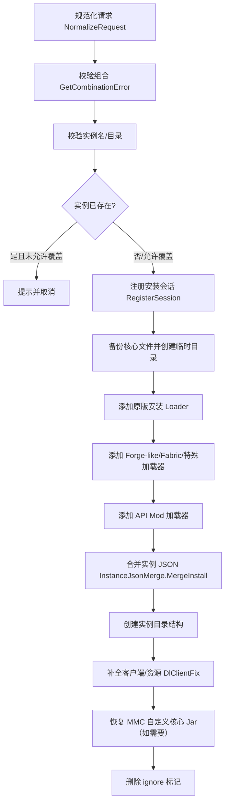

# 08 · 业务核心（PCL.Launcher.Core）

`PCL.Launcher.Core` 是启动器的业务引擎：它知道“怎么安装、怎么下载、怎么启动、怎么导入整合包、怎么更新”，但不关心“按钮长什么样”。所有界面交互都通过 `PCL.Launcher.Core/Ui` 中定义的契约（由 `PCL.Launcher` 实现）完成。

> 命名空间：本项目的代码使用根命名空间 `PCL`（不是 `PCL.Launcher.Core`），例如 `PCL.GameLaunch`、`PCL.McInstance`、`PCL.LauncherPaths`。

## 1. 目录结构

```text
PCL.Launcher.Core
├── Comp/                  # 社区资源：查询、下载、收藏、数据库、快速下载
├── CompDependency/        # 资源依赖解析
├── CrashAnalysis/         # 崩溃分析
├── Download/              # 游戏/加载器下载与安装请求
├── Event/                 # 业务事件
├── Install/               # 安装管线、恢复、实例 JSON 合并
├── Launch/                # 启动检查、参数、Java、登录、Natives、进程
├── Loading/               # 任务/组合任务/进度框架
├── LocalComp/             # 本地资源（mods、资源包等）
├── Minecraft/             # 实例模型、版本比较、实例列表、Java、库、JarInJar
├── Modpack/               # 整合包解析（CurseForge/Modrinth/MultiMC/HMCL/MCBBS/LauncherPack）
├── Network/               # 下载器、加载器、HTTP、WebServer、管理
├── Updates/               # 启动器自更新
├── Ui/                    # 业务层 UI 契约
├── Watcher/               # 文件监视
├── Xaml/                  # XAML 值转换/验证辅助
├── FileChecker.cs
├── LauncherPaths.cs
├── LauncherState.cs
├── SafeList.cs
├── Search.cs
```

## 2. 路径与全局状态

### 2.1 `LauncherPaths`

| 属性 | 含义 |
|---|---|
| `ExecutableDirectory` | 启动器可执行文件目录（带尾分隔符） |
| `UserDataRoot` | 用户数据根目录：`PCL_DATA_DIR` > 打包形态（`~/PCLCE`）> 可执行文件目录 |
| `DefaultMinecraftDirectory` | 默认 `.minecraft`：`PCL_MINECRAFT_DIR` > `PCL_DATA_DIR/.minecraft` > 打包形态 `~/PCLCE/.minecraft` > 可执行目录下 `.minecraft` |
| `MinecraftFolder` | 当前使用的 Minecraft 根目录（由宿主设置） |
| `Temp` | 临时目录（`Paths.Temp`） |
| `PureAsciiDirectory` | 不含非 ASCII 字符的临时目录，优先数据目录，其次系统临时目录 |
| `OfficialMinecraftDirectory` | 官方启动器的游戏目录（Windows `%APPDATA%\.minecraft`，macOS `~/Library/Application Support/minecraft`，Linux `~/.minecraft`） |
| `ImageRoot` | 内嵌图片 URI 根 |

实例路径规则：

```text
<MinecraftFolder>/versions/<InstanceName>/
```

若传入绝对路径，则直接作为实例目录。

### 2.2 `LauncherState`

保存进程级业务状态（当前选中的 `McInstance` 及切换事件），供 UI 清理缓存与刷新。真正的实例列表在 `Minecraft/InstanceList`。

### 2.3 其他根级类型

- `FileChecker`：文件完整性校验（大小、哈希、缺失）。
- `SafeList<T>`：线程安全列表。
- `Search`：本地搜索（实例、资源）。

## 3. Minecraft 实例模型

### 3.1 `McInstance`（`Minecraft/McInstance.cs`）

核心字段/属性：

| 成员 | 说明 |
|---|---|
| `PathInstance` | 实例目录（带尾分隔符） |
| `PathIndie` | 应用“版本隔离”后的游戏根目录 |
| `Name` | 实例名 |
| `Info` | `McInstanceInfo`，解析后的版本信息（延迟加载） |
| `state` | `McInstanceState`：正常、快照、旧版、愚人节、错误等 |
| `IsLoaded` | 是否已加载 |
| `IsStar` | 是否收藏 |
| `Logo` | 图标 |
| `CustomDesc` / `Desc` / `RuntimeDesc` | 自定义/运行时/默认描述（`Desc` 每次按语言求值） |
| `displayType` | `McInstanceCardType`：自动/隐藏/自定义分类 |
| `releaseTime` | 发布时间 |
| `Modable` | 是否可安装 Mod |

版本隔离（`PathIndie`）判定优先级：

1. 旧配置 `IndieV1` 迁移；
2. 实例目录存在非空 `mods` 或 `saves` → 自动隔离；
3. 全局 `Config.Launch.IndieSolutionV2`：
   - 0 关闭；
   - 1 仅隔离可装 Mod 或 LabyMod 的实例；
   - 2 仅隔离非正式版；
   - 3 隔离非正式版与可装 Mod 的实例；
   - 其他/默认隔离全部。
4. 结果写入 `Config.Instance.IndieV2`（按实例路径参数化）。

### 3.2 `McInstanceInfo`

解析 `versions/<name>/<name>.json`：

- 从 `releaseTime`、`clientVersion`、HMCL patches、Forge/NeoForge/LabyMod arguments、继承实例等来源推断版本号。
- 识别加载器（Forge、NeoForge、Fabric、Quilt、OptiFine、LiteLoader、LabyMod 等）。
- 提供 `HasLabyMod`、`Modable` 等派生属性。

### 3.3 其他

- `McInstanceState`：实例状态。
- `McInstanceCardType`：卡片分类。
- `McVersionComparer`：版本号比较（支持快照、预发布等）。
- `McConstraintMatcher`：版本/加载器约束匹配（供资源依赖与安装校验）。
- `InstanceRenameService`：重命名实例目录与配置键。
- `Minecraft/InstanceList`：实例枚举、选中项、排序、缓存。

## 4. 安装管线

### 4.1 入口

```csharp
// 构建加载器列表（由调用方创建外层 LoaderCombo 并启动）
List<LoaderBase> loaders = McInstallPipeline.CreateInstallLoader(request, ignoreDump: false);
```

`McInstallRequest`（`Download/McInstallRequest.cs`）描述安装目标：

- 原版版本名 `minecraftName`
- 目标实例名/目录
- 加载器选择（Forge、NeoForge、Cleanroom、Fabric、LegacyFabric、Quilt、OptiFine、LiteLoader、LabyMod）
- 整合包信息（`mmcPackInfo`、LabyMod 频道等）

### 4.2 组合约束

`McInstallPipeline.GetCombinationError` 会拒绝互斥组合：

- Forge / NeoForge / Cleanroom 三者互斥；
- Fabric / LegacyFabric / Quilt 互斥；
- LiteLoader 与部分加载器不兼容；
- OptiFine 与部分加载器组合需特殊处理。

### 4.3 步骤



关键类型：

| 类型 | 职责 |
|---|---|
| `McInstallPipeline` | 组装安装加载器、校验组合、备份与清理 |
| `McInstallRecovery` | 安装会话注册、备份、失败回滚、临时目录规范化 |
| `InstanceJsonMerge` | 合并原版 + 各加载器 JSON，生成最终实例 JSON |
| `LoaderInstallerInstall` | 运行安装器（Forge/NeoForge 等） |
| `LoaderProfileInstall` | 生成加载器 profile |
| `LoaderSpecialInstall` | LiteLoader/LabyMod/OptiFine 特殊安装 |
| `Download/Forge.cs`、`Fabric.cs`、`NeoForgeCleanroom.cs`、`OptiFine.cs`、`LiteLoader.cs`、`LabyMod.cs`、`LegacyFabric.cs` | 各加载器下载逻辑 |

### 4.4 失败恢复

- 安装会话在失败/取消时由 `McInstallRecovery` 回滚。
- 安装前备份核心文件（JSON、Jar），避免覆盖安装损坏原实例。
- 不完整实例目录在下次安装时清理。
- MMC 整合包覆盖原版 Jar 时，会暂存并在补全后恢复。

## 5. 启动管线

### 5.1 入口

```csharp
// 必须在 UI 线程调用
bool started = GameLaunch.McLaunchStart(options);
```

`McLaunchOptions`：

- `ExtraArgs`：附加参数；
- `IsTest`：测试启动（显示实时日志）；
- `SaveBatch`：导出启动脚本而不启动；
- `ServerIp` / `WorldName`：启动后进入服务器/存档；
- `instance`：临时指定实例。

### 5.2 预检查

`McLaunchPrecheck`：

1. 可选随机延迟（调试）；
2. 路径校验：禁止 `!`、`;`；非 ASCII 路径提示（可记住选择）；
3. 实例校验：必须已选择、加载成功、状态非 Error；
4. 账户校验：必须存在有效档案；LabyMod 要求微软账户；按实例登录要求校验微软/第三方/离线；
5. Beta 构建显示赞助提示；正式构建在缺少微软档案时显示购买提示（可进入演示模式）。

### 5.3 阶段（`LaunchStage*Id`）

| 顺序 | 阶段 ID | 方法 | 说明 |
|---|---|---|---|
| 1 | `Launch:GetJava` | `McLaunchJava` | 选择/校验 Java |
| 2 | `Launch:Login` | `mcLoginLoader` | 登录/刷新令牌 |
| 3 | `Launch:CompleteFiles` | `GameDownload.DlClientFix` | 补全客户端、库、资源（后台下载资源索引） |
| 4 | `Launch:GetArguments` | `McLaunchArgumentMain` | 生成 JVM/游戏参数 |
| 5 | `Launch:ExtractNatives` | `McLaunchNatives` | 解压/替换 Natives |
| 6 | `Launch:PreLaunch` | `McLaunchPrerun` | 启动前准备（目录、配置、外部程序） |
| 7 | `Launch:CustomCommand` | `McLaunchCustom` | 自定义命令 |
| 8 | `Launch:StartProcess` | `McLaunchRun` | 创建进程 |
| 9 | `Launch:WaitWindow` | `McLaunchWait` | 等待游戏窗口 |
| 10 | `Launch:End` | `McLaunchEnd` | 收尾（统计、日志、Watcher） |

外层是 `Launch:Root` 组合任务，进度权重分别为 4、登录、15、2、2、1、1、2、1、1。

### 5.4 相关文件

| 文件 | 职责 |
|---|---|
| `Launch/Arguments.cs` | 参数主流程、变量替换、条件规则 |
| `Launch/ArgumentsJvm.cs` | JVM 参数（内存、GC、系统属性、日志） |
| `Launch/ArgumentsGame.cs` | 游戏参数（用户名、UUID、资源目录、窗口等） |
| `Launch/Java.cs` | Java 选择与版本校验 |
| `Launch/Login.cs` | 登录加载器与令牌刷新 |
| `Launch/Natives.cs` | Natives 解压、架构替换、Mesa 等特殊处理 |
| `Launch/Run.cs` | 进程启动、输出重定向、日志过滤 |
| `Launch/GpuPreferenceCommand.cs` | GPU 偏好命令封装 |
| `Launch/Core.cs` | 预检查、阶段编排、结果处理 |

### 5.5 日志与安全

- `GameLaunch.McLaunchLog` 会对用户名与 AccessToken 做脱敏。
- 失败时区分普通异常与 `$` 前缀的“特殊消息”（直接展示给用户）。
- 启动成功后由 `GameWatcher.Watcher` 监视进程退出、崩溃与日志。

## 6. 下载与网络

`PCL.Launcher.Core/Download` 与 `Network` 组成下载体系：

| 类型 | 职责 |
|---|---|
| `Download/Core.cs` | 下载入口、版本清单、资源索引、客户端补全 |
| `Download/Network.cs` | 下载网络配置（源、重试、代理） |
| `Download/McInstallRequest.cs` | 安装请求模型 |
| `Download/DownloadUserInteraction.cs` | 下载中的用户交互（确认、提示） |
| `Download/Forge.cs` | Forge 安装器下载与执行 |
| `Download/NeoForgeCleanroom.cs` | NeoForge/Cleanroom |
| `Download/Fabric.cs` / `LegacyFabric.cs` | Fabric 系 |
| `Download/OptiFine.cs` / `LiteLoader.cs` / `LabyMod.cs` | 特殊加载器 |
| `Network/Downloader/` | 多线程下载器、分片、限速、重试 |
| `Network/Loaders/` | 各下载源加载器 |
| `Network/Facade/` | 网络门面 |
| `Network/Http/` | 业务 HTTP 封装 |
| `Network/Management/` | 下载任务管理 |
| `Network/Models/` | 网络模型 |
| `Network/WebServer/` | 本地 Web 服务（回调/资源） |

下载行为受 `Config.Download` 控制：线程数、单文件连接数、限速、HTTP 模式、文件源、版本列表源、自动选择实例、Authlib 修复、资源命名格式、自动依赖等。

## 7. 加载框架（`Loading`）

`Loading` 是一套与 UI 解耦的任务/进度框架：

| 类型 | 职责 |
|---|---|
| `LoaderBase` | 所有加载器基类：状态、进度、错误、取消 |
| `LoaderTask<TIn,TOut>` | 单步任务 |
| `LoaderCombo` / `LoaderComboGeneric<T>` | 组合任务（并行/顺序） |
| `LoaderFolderEntry` | 文件夹级任务（批量文件） |
| `Loading/Core.cs` | 全局任务栏、状态事件 |
| `LoadingUi.cs` / `LoadingContracts.cs` | 业务层 UI 契约（进度显示、任务栏） |

UI 通过实现 `Loading` 契约展示进度；核心逻辑不直接操作控件。

## 8. 社区资源（`Comp`）

`Comp` 负责 CurseForge / Modrinth 等资源的查询、下载、依赖与本地管理：

| 文件 | 职责 |
|---|---|
| `Core.cs` | 资源总入口、源选择 |
| `Project.cs` / `ProjectQuery.cs` / `ProjectRequest.cs` | 项目模型、查询、请求 |
| `ProjectProps.cs` / `ProjectBuild.cs` | 项目属性、构建信息 |
| `File.cs` / `FileCache.cs` | 文件模型与缓存 |
| `Database.cs` | 本地资源数据库 |
| `Favorites.cs` | 收藏 |
| `QuickDownload.cs` | 快速下载（剪贴板/链接识别） |
| `ProjectStorage.cs` | 项目持久化 |
| `CompDownloadLoaders.cs` | 资源下载加载器 |
| `Request.cs` | 通用请求 |

`CompDependency` 负责：

- 解析依赖（必需/可选）；
- 版本约束匹配（`McConstraintMatcher`）；
- 加载器/游戏版本过滤；
- 生成安装计划（避免重复、冲突提示）。

`LocalComp` 负责已安装资源（mods、资源包、光影、世界等）的扫描与管理。

## 9. 整合包（`Modpack`）

| 格式 | 文件 |
|---|---|
| CurseForge | `CurseForge.cs` |
| Modrinth | `Modrinth.cs` |
| MultiMC / MMC | `MultiMC.cs`、`MmcPackInfo.cs` |
| HMCL | `HMCL.cs` |
| MCBBS | `MCBBS.cs` |
| LauncherPack | `LauncherPack.cs` |
| 通用压缩包 | `Compress.cs`、`Core.cs` |

导入流程：

1. 识别格式（manifest/index/压缩包结构）；
2. 解析游戏版本与加载器；
3. 下载/解析资源清单；
4. 组装 `McInstallRequest`；
5. 走安装管线；
6. 写入实例描述、图标、封面等元数据。

`MmcPackInfo` 表示 MMC 包对原版 Jar 的覆盖信息（安装时需保留/恢复）。

## 10. 更新（`Updates`）

| 类型 | 职责 |
|---|---|
| `UpdateManager` | 检查更新、选择源、下载、校验、触发替换 |
| `IUpdateSource` / `UpdateSourceChannel` | 更新源接口与渠道 |
| `IUpdatePolicy` | 更新策略（是否提示、是否自动下载） |
| `UpdateUi` | 更新 UI 契约 |
| `UpdatesMinioModel` / `UpdatesMirrorChyanModel` / `UpdatesRandomModel` / `UpdatesWrapperModel` | 不同更新源模型 |
| `VersionDataModel` / `VersionAnnouncementDataModel` | 版本与公告模型 |
| `AnnouncementService` | 公告拉取 |
| `UpdateEnums` | 枚举 |

更新流程使用 `BsDiff`（见 [04-IO-网络-存储与工具.md](04-IO-网络-存储与工具.md)）做增量补丁，退出后替换可执行文件并重启。

## 11. 崩溃分析与监视

- `CrashAnalysis/` 与 `Minecraft/CrashAnalysis/`：解析崩溃报告、定位可疑 Mod、生成可读结论。
- `Watcher/` 与 `Minecraft/Watcher`：监视游戏进程、日志文件、窗口状态；配合 `GameWatcher.Watcher`。
- `Launch/Core.cs` 在启动成功后注册 `mcLaunchWatcher`。

## 12. UI 契约（`Ui/`）

业务层不直接弹窗，而是定义接口，由界面层实现：

| 契约 | 用途 |
|---|---|
| `ILaunchUi` | 启动页刷新、日志、按钮、导航 |
| `ILoadingUi` | 加载进度/任务栏 |
| `ICompUi` | 资源详情、下载确认、依赖选择 |
| `IUpdateUi` | 更新提示与进度 |
| `ILauncherUi` | 通用交互（打开网页、提示） |
| `NavigationService` | 业务层触发的导航（详情页、任务管理器、实例选择） |

这些契约由 `PCL.Launcher/Composition/UiServiceRegistration` 映射到 `*Bridge` 实现（见 [09-界面层与导航.md](09-界面层与导航.md)）。

## 13. 扩展建议

- 新增加载器：在 `Download/` 增加下载器，在 `McInstallPipeline` 注册加载器，并在 `InstanceJsonMerge` 处理 JSON 合并。
- 新增整合包格式：在 `Modpack/` 增加解析器，输出统一 `McInstallRequest`。
- 新增业务 UI 交互：在 `Ui/` 定义接口，在界面层实现并注册。
- 新增下载源：实现 `Network/Loaders` 中的加载器接口，并在源选择处注册。
- 任何长任务都应使用 `Loading` 框架，以便统一进度、取消与错误处理。
