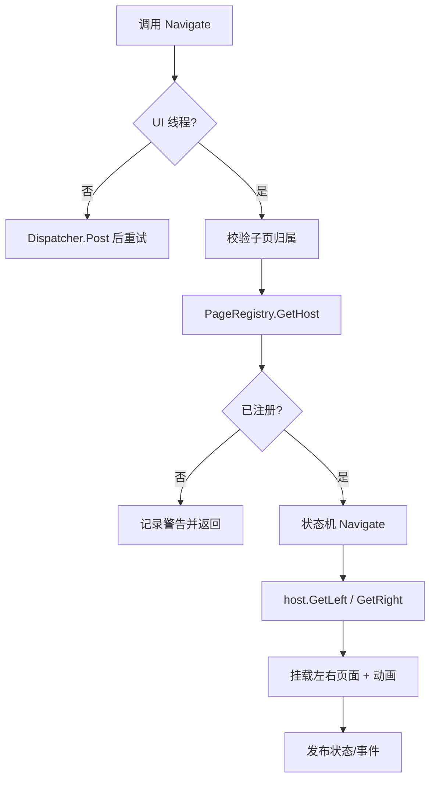

# 09 · 界面层与导航（PCL.Launcher）

`PCL.Launcher` 是唯一的可执行项目，也是组合根。它承担四件事：

1. 选择平台/UI 实现并构建 DI 容器；
2. 启动 Avalonia、创建主窗体；
3. 提供页面目录、路由、页面宿主与 View/ViewModel；
4. 实现业务层的 UI 契约（Bridge），把业务事件转成界面行为。

## 1. 启动与组合根

### 1.1 `Program`

`Program.Main` 的职责：

1. `PlatformDetector.Detect()`；
2. `PlatformStartup.Initialize(kind, args)`；
3. `PlatformRegistration.Register(kind)`；
4. `LauncherServiceRegistration.Build(applicationServices)`；
5. `StartupCommandHandler.TryHandle(args, provider)`；
6. `PlatformStartup.Configure(kind)`；
7. 初始化页面注册表、动画、应用/主窗体工厂；
8. `Lifecycle.OnInitialize()`。

### 1.2 `PlatformStartup`

根据 `PlatformKind` 创建具体启动类：

- `WindowsPlatformStartup`
- `LinuxPlatformStartup`
- `MacOsPlatformStartup`

每个实现负责：

- `Initialize`：平台早期准备（编码、DPI、环境变量、原生库路径等）；
- `Configure`：构造 Avalonia `AppBuilder`（窗口系统、字体、渲染后端、Wayland/X11 选择等）。

### 1.3 `PlatformRegistration`

```csharp
var services = new ApplicationServices
{
    Platform = PlatformModuleFactory.Create(kind),
    Ui = UiModuleFactory.Create(kind)
};
ApplicationRuntime.Initialize(services);
```

### 1.4 `LauncherServiceRegistration`

`Build(ApplicationServices)`：

- 注册 `ApplicationServices`、`PlatformModule`、`UiModule`、`IPlatformCapabilities`；
- `AddPlatformServices(kind)`（原生服务）；
- `AddAvaloniaUi(kind)`（UI 适配服务）；
- 注册导航：`INavigationService`、`PageCatalog.Snapshot`、`PageHostFactory`、`PageViewFactory`；
- `AddLauncherUi()`（桥接服务）；
- `UiServiceRegistration.Validate(services)`（校验必需服务）；
- 按平台注册 `IUpdatePolicy`、`IPlatformFontProvider`、`ITaskbarProgressBackend`；
- 注册页面左侧控件与设置页 ViewModel（页面右侧由 `PageViewFactory` 创建）；
- 使用 `ValidateOnBuild = true`、`ValidateScopes = true` 构建容器。

## 2. 导航系统

导航系统位于 `PCL.Launcher/Navigation`，设计目标是“页面描述数据化、宿主可缓存、路由可测试”。

### 2.1 标识类型

| 类型 | 说明 |
|---|---|
| `MainTab` | 标题栏四个主入口：`Launch`、`Download`、`Tools`、`Setup` |
| `PageId` | 顶级页面稳定 ID（字符串 record struct） |
| `SubPageId` | 子页面 ID，包含父页面，避免不同模块重名 |
| `PageLocation` | 顶级页面 + 可选子页面 |
| `PageRoute` | 位置 + 参数 + 可选标题覆盖 |
| `PageParameter` | 路由参数（实例名、项目 ID 等） |

顶级页面 ID（`PageIds`）：`Launch`、`Download`、`Tools`、`Setup`、`InstanceSelect`、`TaskManager`、`InstanceSetup`、`CompDetail`、`HelpDetail`、`GameLog`、`VersionSaves`。

子页面 ID（`SubPageIds`）按父页面分组，例如：

- 下载：`DownloadInstall`、`DownloadMod`、`DownloadPack`、`DownloadResourcePack`、`DownloadShader`、`DownloadWorld`、`DownloadCompFavorites`、`DownloadClient`、`DownloadForge`、`DownloadFabric` 等；
- 设置：`SetupLaunch`、`SetupUi`、`SetupGameManage`、`SetupLink`、`SetupAbout`、`SetupLog`、`SetupJava`、`SetupUpdate`、`SetupLauncherLanguage` 等；
- 实例设置：`VersionOverall`、`VersionSetup`、`VersionExport`、`VersionWorld`、`VersionMod`、`VersionScreenshot` 等；
- 工具：`ToolsGameLink`、`ToolsTest`。

### 2.2 页面描述

`PageDescriptor`（顶级页面）：

```csharp
public sealed record PageDescriptor(
    PageId Id,
    string TitleKey,
    string? IconKey,
    MainTab? Tab,
    double LeftWidth,
    SubPageId? DefaultSubPage,
    IReadOnlyList<PageGroupDescriptor> Groups,
    IReadOnlyList<SubPageDescriptor> SubPages,
    Func<IServiceProvider, PageDescriptor, IPageHost>? CreateHost = null);
```

`SubPageDescriptor`（子页面）：

```csharp
public sealed record SubPageDescriptor(
    SubPageId Id,
    string TitleKey,
    string? IconKey,
    string? GroupKey,
    int Order,
    Func<IServiceProvider, PageRoute, Control> CreateRight,
    Func<bool>? IsVisible = null,
    bool CanRefresh = false,
    string? ResetMessageKey = null,
    double LogoScale = 1d);
```

`PageDescriptor` 提供：

- `FindSubPage`、`NormalizeSubPage`：归一化空/未知/隐藏子页；
- `FirstVisibleSubPage`、`VisibleSubPages`：按可见性与排序；
- `IsVisible`：调用子页可见性委托（权限、功能开关等）。

`MainTabDescriptor` 描述主入口（默认页面、标题、图标、顺序、Logo 缩放）。

### 2.3 页面模块

`IPageModule` 暴露 `Pages` 与 `MainTabs`。现有模块：

| 模块 | 负责页面 |
|---|---|
| `LaunchPageModule` | 启动页 |
| `DownloadPageModule` | 下载（原版/加载器/资源/整合包/收藏） |
| `SetupPageModule` | 设置（启动/UI/游戏管理/联机/关于/日志/更新/Java/语言） |
| `ToolsPageModule` | 工具（联机测试、游戏链接等） |
| `InstancePageModule` | 实例选择与实例设置（含世界、Mod、截图、导出） |
| `ShellPageModule` | 外壳级页面（任务管理器、帮助详情、游戏日志等） |

`PageCatalogBuilder.Build(modules)` 汇总、校验并生成只读 `PageCatalogSnapshot`；`PageCatalog` 用 `Lazy` 缓存快照，并提供解析/查找方法。

### 2.4 页面宿主

`IPageHost`：

```csharp
public interface IPageHost
{
    PageId Page { get; }
    MainTab? Tab { get; }
    double LeftWidth => 210d;
    bool IsSecondary => Tab is null;
    string GetTitle(PageRoute route);
    Control? GetLeft(PageRoute route);
    Control GetRight(PageRoute route);
}
```

- 顶级页面有 `Tab`，二级页面为 `null`。
- 宿主缓存左右页面实例，保证往返切换不丢状态。
- `PageHostFactory.Create(descriptor)` 调用描述中的 `CreateHost` 工厂，通过 `ActivatorUtilities` 从 DI 创建宿主。
- `PageViewFactory.Create(subPage, route)` 调用子页描述的 `CreateRight`，创建右栏控件。

### 2.5 页面注册表

`PageRegistry`：

- `Initialize(PageHostFactory)` 由组合根调用；
- 首次访问 `All` / `GetHost` 时懒初始化：遍历 `PageCatalog.Pages`，创建宿主并登记；
- `PageOfTab` / `TabOfPage` 委托给 `PageCatalog`；
- 重复注册、创建失败、空目录都会记录日志。

### 2.6 路由

`PageRouter` 是导航执行器：

| 方法 | 说明 |
|---|---|
| `Attach(leftHost, rightHost)` | 绑定左右栏容器 |
| `ShowStandalone(page)` | 只显示右栏页面（无左栏） |
| `Navigate(MainTab)` | 切到主 Tab 的默认/历史页面 |
| `Navigate(PageId, SubPageId?, PageParameter?)` | 按页面导航 |
| `Navigate(PageLocation, parameter)` | 按位置导航 |
| `Navigate(PageRoute)` | 核心入口 |
| `Back()` | 返回上一页 |
| `RefreshState()` | 重新发布导航状态 |

行为要点：

- 非 UI 线程调用会自动 `Post` 回 UI 线程。
- 校验子页必须属于父页。
- 未注册页面会记录警告并放弃导航。
- 相同位置重复导航会被忽略。
- 导航期间 `_isNavigating` 防重入；使用 `AnimationService.BeginControl()` 控制转场动画。
- 页面切换有 110ms 换页延迟、30ms 进入延迟，并触发 `PageHostSwapped`。
- 发布 `Navigated`、`PageChanged` 事件，刷新快捷按钮。

### 2.7 导航状态机

`PageNavigationStateMachine` 是纯逻辑、无 Avalonia 依赖，便于 headless 测试：

- 维护 `Current`、`BackStack`、各主 Tab 的历史位置；
- 二级页面入栈；同一页面内的子页切换不重复入栈；
- 顶级页面切换清空返回栈；
- `Back()` 返回栈顶目标（不直接弹出，由后续导航更新栈），空栈回退到启动页。

`PageNavigationState` 是发布给外壳的只读快照：当前路由、标题、是否二级页面、所属 Tab、能否返回、左栏宽度。

### 2.8 导航服务

`INavigationService` / `NavigationService.Instance` 是给页面与 ViewModel 的薄适配层：

```csharp
NavigationService.Instance.GoTo(new PageLocation(PageIds.InstanceSetup, SubPageIds.VersionMod), parameter);
NavigationService.Instance.GoBack();
```

`Navigated` 事件由 `PageRouter` 在状态发布时触发。

### 2.9 导航流程图



## 3. 视图与 ViewModel

### 3.1 目录

```text
PCL.Launcher
├── Views/
│   ├── MainWindow.axaml(.cs)
│   ├── Shell/                 # 标题栏、左栏、快捷按钮等外壳
│   └── Pages/
│       ├── Launch/            # 启动页、登录页
│       ├── Download/          # 下载页、安装/资源/整合包
│       ├── Instance/          # 实例选择与实例设置
│       ├── Setup/             # 设置各子页
│       ├── Tools/             # 工具页
│       ├── Log/               # 日志页
│       ├── Select/            # 选择器页面
│       ├── Speed/             # 速度测试/诊断
│       ├── Help/              # 帮助详情
│       └── Homepage/          # 主页/公告
├── ViewModels/
│   ├── Pages/                 # 页面级 ViewModel
│   ├── Launch/
│   ├── Download/
│   ├── Instance/
│   └── Setup/
└── UI/
    ├── Bridges/               # 业务 UI 契约实现
    ├── Controls/              # 自定义控件（按钮、输入、导航、SVG 图标等）
    ├── Dialogs/               # 对话框（登录、选择、输入、Markdown）
    ├── Events/                # 交互事件
    ├── Install/               # 安装相关 UI 辅助
    ├── Localization/          # 本地化辅助
    ├── Styles/                # 样式
    ├── SystemIntegration/     # 字体、任务栏进度等
    ├── Theming/               # 主题
    ├── Xaml/                  # 值转换/标记扩展
    ├── DialogPresenter.cs     # 对话框呈现
    ├── HintPresenter.cs       # 提示呈现
    ├── FeedbackUiService.cs   # 反馈 UI
    ├── UiInteraction.cs       # 通用交互与多个 Bridge
    └── WindowContext.cs       # 窗口上下文
```

### 3.2 页面与宿主示例

以启动页为例：

- `LaunchPageModule` 声明 `PageIds.Launch`，`CreateHost` 通过 `ActivatorUtilities` 创建 `PageLaunchHost`；
- `PageLaunchHost` 实现 `IPageHost`，负责标题、左栏（`PageLaunchLeft`）、右栏（`PageLaunchRight`）、登录页切换；
- `PageLaunchLeft` / `PageLaunchRight` 是 Avalonia 控件，XAML 使用编译绑定；
- 业务状态来自 `PCL.Launcher.Core` 的 `InstanceList`、`GameLaunch`、`ProfileService`。

下载页类似：`PageDownloadHost` + 多个子页（安装、Mod、整合包、资源包、光影、世界、收藏）。

### 3.3 ViewModel 约定

- 继承 `ViewModelBase` 或 `LocalizedObservableObject`；
- 使用 CommunityToolkit 的 `[ObservableProperty]`、`[RelayCommand]`；
- 通过 `INavigationService` 导航，不直接操作 `PageRouter`；
- 通过构造函数注入服务（`PageViewFactory` / `ActivatorUtilities` 创建）；
- 本地化文本使用 `Lang.Text` 或本地化属性。

## 4. UI 桥接

业务核心通过 `PCL.Launcher.Core/Ui` 的接口与界面交互。`UiServiceRegistration` 将这些接口映射到实现：

| 业务契约 | 实现 | 作用 |
|---|---|---|
| `ILoadingUi` | `LoadingUiBridge` | 加载进度、任务栏 |
| `IUserInteraction` | `UserInteractionBridge`（`UiInteraction.cs`） | 通用提示、确认 |
| `IDownloadUserInteraction` | `DownloadInteractionBridge` | 下载确认/选择 |
| `IUpdateUi` | `UpdateUiBridge` | 更新提示与进度 |
| `IAnnouncementActionHandler` | `AnnouncementActionsBridge` | 公告操作 |
| `IWatcherUi` | `WatcherUiBridge` | 进程/日志监视提示 |
| `IMediaService` | `MediaServiceBridge` | 背景音乐 |
| `ICrashAnalysisService` | `CrashAnalysisBridge` | 崩溃分析展示 |
| `ICompNavigationService` | `CompNavigationBridge` | 资源详情导航 |
| `ICompUi` | `CompUiBridge` | 资源 UI |
| `ICompLocalUi` | `CompLocalUiBridge` | 本地资源 UI |
| `IMemorySettings` | `MemorySettingsBridge` | 内存设置 |
| `ILaunchUi` | `LaunchUiBridge` | 启动页交互 |
| `IProfileUi` | `ProfileUiBridge` | 账户 UI |
| `ILogFilter` | `LogFilterBridge` | 日志过滤 |
| `IRestrictedFeatures` | `RestrictedFeaturesBridge` | 受限功能提示 |
| `IModpackUi` | `ModpackUiBridge` | 整合包导入 UI |
| `IEventUi` | `EventUiBridge` | 业务事件 UI |

`UiServiceRegistration.Validate` 会在容器构建前检查缺失项，避免运行时空引用。

## 5. 对话框与提示

| 类型 | 职责 |
|---|---|
| `DialogPresenter` | 统一打开对话框、设置所有者、返回结果 |
| `HintPresenter` | 顶部/内嵌提示（成功、警告、错误） |
| `FeedbackUiService` | 用户反馈收集 |
| `WindowContext` | 当前窗口、所有者、焦点等上下文 |
| `UiInteraction` | 静态交互辅助（打开网页、复制、提示） |
| `Dialogs/` | `MyMsgDialogBase`、`MyMsgText`、`MyMsgSelect`、`MyMsgInput`、`MyMsgMarkdown`、`MyMsgLogin`、`MyMsgAuthServer` 等具体对话框 |

原则：业务层只调用契约，界面层决定具体呈现方式。

## 6. 主题、样式与控件

- `UI/Theming`：主题管理（深浅色、强调色、资源字典）。
- `UI/Styles`：全局样式、间距、字体。
- `UI/Controls`：
  - `Buttons`、`Inputs`、`Menus`、`Containers`、`Feedback`、`Navigation`；
  - `Minecraft`：Minecraft 专用展示（皮肤、服务器状态等）；
  - `SvgIcon`：SVG 图标渲染；
  - `Behaviors`：Avalonia 行为。
- `UI/SystemIntegration`：`IPlatformFontProvider`（Windows/macOS/Linux 字体）、`ITaskbarProgressBackend`（任务栏进度）。
- `UI/Xaml`：值转换器、标记扩展。
- `UI/Diagnostics`：界面诊断（布局、性能）。

## 7. 背景音乐

`Media/`：

- `MediaPlaybackService`：播放/暂停/音量/切歌/状态。
- `MiniAudioMusicBackend`：基于 `JAJ.Packages.MiniAudioEx` 的后端。
- 通过 `IMediaService` 暴露给业务层，`MediaServiceBridge` 负责适配。

## 8. 启动命令处理

`Composition/StartupCommandHandler` 使用 `PCL.Core/App/Cli` 解析参数，在创建主窗体前执行：

- 打开指定页面/实例；
- 执行维护/诊断命令；
- 单实例转发（由 `SingleInstanceService` 配合）。

返回 `true` 表示命令已完全处理，无需继续启动。

## 9. 如何新增一个页面

1. 在 `PageIds` 或 `SubPageIds` 添加稳定 ID。
2. 在对应 `*PageModule` 中声明 `PageDescriptor` / `SubPageDescriptor`，指定标题 key、图标、分组、顺序、可见性与 `CreateRight`。
3. 创建 `Views/Pages/...` 控件与 `ViewModels/...`（如需要）。
4. 若为顶级页面，实现 `IPageHost`（左栏/右栏/标题/缓存）并在描述中提供 `CreateHost`。
5. 若左栏控件需要 DI，在 `LauncherServiceRegistration` 注册为 `Transient`；右栏通过 `PageViewFactory` 创建。
6. 在 `PCL.Localization/Languages/*.axaml` 添加标题与文本 key。
7. 在 `PCL.Core.Test` 的导航/架构测试中补充断言（如页面已注册、无重复 ID）。

## 10. 架构约束

- 页面不得直接 `new` 平台/业务单例，使用注入或静态门面（`ApplicationRuntime`、`NavigationService`）。
- 页面不得直接操作 `PCL.Launcher.Core` 的内部字段；通过公开 API / UI 契约。
- 所有导航必须在 UI 线程；非 UI 线程使用 `PageRouter` 的自动 `Post` 或 `IUiDispatcher`。
- 新页面必须有本地化 key，不允许硬编码中文/英文文案。
- XAML 默认使用编译绑定；新增绑定要保证 `x:DataType` 正确。
