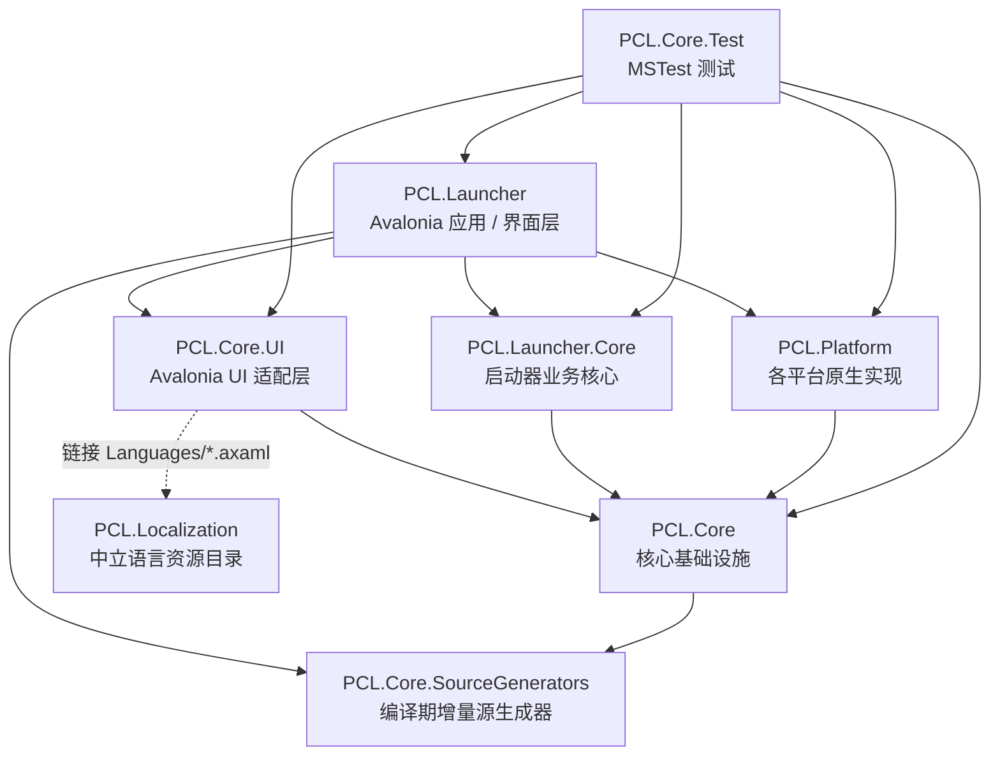

# PCL Community Edition · Code Wiki

本目录是对 PCL Community Edition（PCL CE，仓库代号 PCL-CE.Neo）源码的结构化解读，面向需要参与开发、排障或二次开发的工程师。内容基于仓库当前源码整理，重点说明**整体架构、模块职责、关键类与函数、依赖关系、运行与发布方式**。

> 说明：本项目是 [PCL](https://github.com/Meloong-Git/PCL) 开源代码的社区二次开发版本。`PCL.Launcher/` 与 `PCL.Launcher.Core/` 使用自定义许可证，其余目录使用 Apache-2.0，详见仓库根目录 `LICENSE` 与 `PCL.Launcher.Core/LICENCE`。

---

## 1. 项目是什么

PCL CE 是一个跨平台的 Minecraft 启动器：

- 运行时：.NET 10（`net10.0`），语言版本 C# 15（`LangVersion 15.0`）
- 界面：Avalonia 12
- 支持平台：Windows 10 1809+ / Windows 11（x64、ARM64）、常见 glibc Linux 桌面（x64、ARM64，X11，Wayland 实验性）、macOS 12+（Apple Silicon 与 Intel）
- 主要能力：Minecraft 原版与各类加载器安装、整合包导入、版本隔离与启动、Java 探测、账户登录、社区资源（CurseForge / Modrinth）、联机大厅、自动更新、崩溃分析等

## 2. 一图看懂分层

依赖方向的核心约束：

1. `PCL.Core` 不依赖 Avalonia，也不依赖任何业务层项目，只暴露抽象接口（平台、UI、日志、配置、IO、Minecraft 基础能力等）。
2. `PCL.Launcher.Core` 只依赖 `PCL.Core`，承载 Minecraft 业务逻辑，不直接操作 Avalonia 控件。
3. `PCL.Core.UI` 只依赖 `PCL.Core`，负责把核心层抽象映射到 Avalonia。
4. `PCL.Platform` 只依赖 `PCL.Core`，按操作系统提供原生能力。
5. `PCL.Launcher` 是唯一的组合根：负责选择平台实现、构建 DI 容器、启动 Avalonia、装配导航与页面。

## 3. 文档目录

| 文档 | 内容 |
|---|---|
| [01-架构总览.md](01-架构总览.md) | 分层架构、启动时序、生命周期、线程模型、关键设计原则 |
| [02-解决方案与项目结构.md](02-解决方案与项目结构.md) | 8 个项目职责、目标框架、NuGet 依赖、目录地图、构建配置 |
| [03-核心基础设施.md](03-核心基础设施.md) | IoC 生命周期、配置系统、事件总线、日志、数据库、CLI、本地化、Essentials 服务 |
| [04-IO-网络-存储与工具.md](04-IO-网络-存储与工具.md) | 文件/目录 API、HTTP/DoH/代理、缓存体系、哈希/加密/校验等工具 |
| [05-Minecraft领域模型.md](05-Minecraft领域模型.md) | Java、账户认证、存档、资源项目、联机大厅、协议与 NBT |
| [06-平台抽象与原生实现.md](06-平台抽象与原生实现.md) | `PCL.Core.Platform` 接口目录、`PCL.Platform` 注册表与平台差异 |
| [07-UI适配层.md](07-UI适配层.md) | Avalonia 宿主、调度器、主题、通知、动画引擎 |
| [08-业务核心.md](08-业务核心.md) | 实例模型、安装管线、启动管线、下载、整合包、社区资源、更新 |
| [09-界面层与导航.md](09-界面层与导航.md) | Program/App、组合根、页面目录、路由、页面宿主、View/ViewModel、桥接 |
| [10-源码生成器.md](10-源码生成器.md) | 6 个增量生成器的输入/输出与使用方式 |
| [11-测试体系.md](11-测试体系.md) | MSTest 组织、架构测试、运行命令、编写建议 |
| [12-构建运行与发布.md](12-构建运行与发布.md) | 环境要求、构建/测试/运行、发布脚本、CI、环境变量、排障 |
| [13-开发规范与扩展指南.md](13-开发规范与扩展指南.md) | 代码规范、提交规范、常见扩展配方、架构边界、术语表 |

## 4. 推荐阅读路径

- **第一次接触项目**：01 → 02 → 09 → 08
- **想改界面**：09 → 07 → 06
- **想加配置项/生命周期服务**：03 → 10 → 13
- **想改下载/安装/启动逻辑**：08 → 05 → 04
- **想移植平台能力**：06 → 03 → 12
- **想跑通并打包**：12 → 11

## 5. 关键事实速查

| 项 | 值 |
|---|---|
| 解决方案 | `PCL Community Edition.slnx` |
| 入口项目 | `PCL.Launcher/PCL.Launcher.csproj`（`WinExe`） |
| 入口方法 | `PCL.Program.Main` |
| UI 框架 | Avalonia `12.1.6` |
| MVVM | `CommunityToolkit.Mvvm` `8.4.2` |
| 测试框架 | MSTest `4.5.3`，`Microsoft.NET.Test.Sdk` `18.12.0` |
| 主要配置 | `Debug` / `CI` / `Release` / `Beta`；平台 `AnyCPU` / `x64` / `ARM64` |
| 数据目录 | 默认可执行文件目录下 `PCL/`；打包形态或不可写时 `~/PCLCE`；可用 `PCL_DATA_DIR` 覆盖 |
| 语言资源 | `PCL.Localization/Languages/*.axaml`，已含 `zh-CN`、`zh-TW`、`en-US`、`en-GB`、`es-ES`、`fr-FR`、`ja-JP` |
| 自定义许可证目录 | `PCL.Launcher/`、`PCL.Launcher.Core/` |
